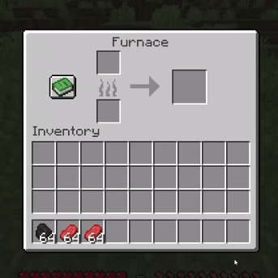

# fast-smelt-datapack

Makes smelting fast (1 tick per item by default) and lets you change the
smelting time in game with a simple `/trigger` command. This means Blast Furnace and Smoker are pretty much redundant. And it works with all smeltable items.

## Change the smelting speed

⚠️ This feature is ONLY on datapack/mod **v1.3.1+** and for **Minecraft 26.3 or newer**.

The speed number in **ticks** and **can't** be zero or negative values. Larger = slower.

| Command                         | Description                        |
|---------------------------------|------------------------------------|
| /trigger fastbrew.speed set 1   | 1 ticks (default)                  |
| /trigger fastbrew.speed set 20  | 20 ticks = 1 second                |
| /trigger fastbrew.speed set 200 | 200 ticks = 10 seconds (vanilla)   |

### Download

- [Releases page](https://github.com/moonbrooke/fast-smelt-datapack/releases)
- [Modrinth](https://modrinth.com/datapack/fast-smelt)
- [CurseForge](https://www.curseforge.com/minecraft/mc-mods/fast-smelt) (Mod)
- [CurseForge](https://www.curseforge.com/minecraft/data-packs/fast-smelt) (Data Pack)
